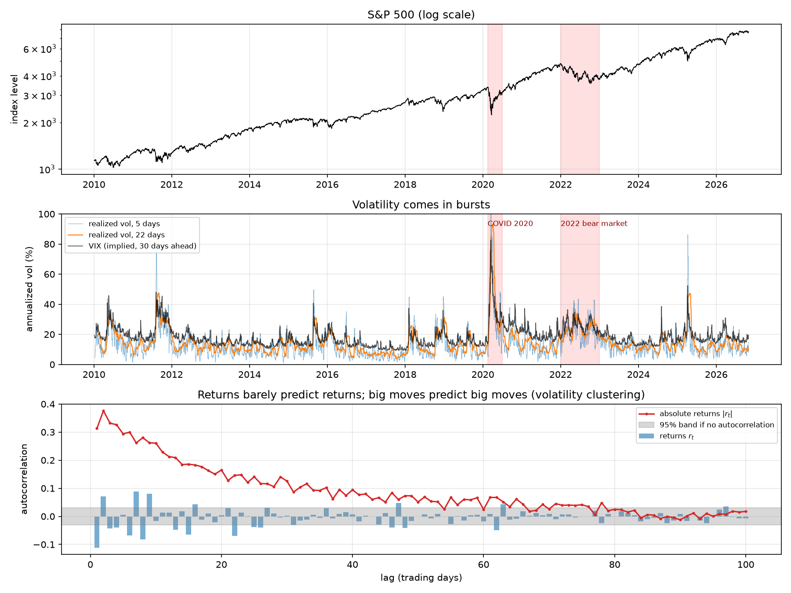
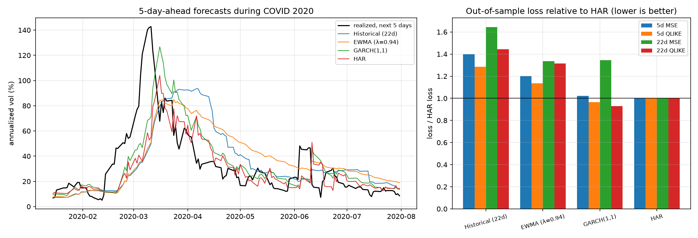

# Does ML beat GARCH? Volatility forecasting with honest evaluation

A computational finance project: forecasting the volatility of the S&P 500 (and later 20–30 stocks and ETFs) with classical econometric models and machine learning, and comparing them **out of sample**, with walk-forward validation and statistical tests. Whatever the result, the method is the point: a model only counts as better if it is better on data it has never seen, by more than luck would explain.

## Highlights

- **Data:** 4,232 trading days of the S&P 500 (2010 to Oct 2026) plus the VIX. Daily returns have excess kurtosis **13.5** (normal: 0), and the VIX sits above subsequent realized vol on **86%** of days.
- **Volatility clustering:** returns themselves are nearly unpredictable, but the autocorrelation of |returns| is **0.31** at lag 1 and still **0.15** a month later, which is what makes volatility forecastable.
- **Baselines (2015–2026, 2,970 out-of-sample days):** HAR has the lowest MSE at both horizons. GARCH(1,1) has the lowest QLIKE (**3%** below HAR at 5 days, **7%** at 22 days). The two loss functions disagree, so "best model" depends on how you score it.
- **No look-ahead, tested:** a unit test scrambles all returns after a cutoff date and checks that no forecast made before it changes.

## Phases

| Phase | Content | Status |
|---|---|---|
| 1 | Data: S&P 500 + VIX, realized volatility, stylized facts | ✅ |
| 2 | Baselines: historical vol, EWMA, GARCH(1,1), HAR | ✅ |
| 3 | ML: XGBoost and a small neural network on vol, returns, volume and VIX features | ⏳ |
| 4 | Evaluation: walk-forward over many assets, MSE/QLIKE, Diebold–Mariano tests, crisis periods | ⏳ |
| 5 | Application: volatility targeting with transaction costs (Sharpe ratio, drawdown) | ⏳ |

## Results

### Phase 1: data and stylized facts



Realized volatility over the past $h$ days, annualized, is

$$
\mathrm{RV}_t^{(h)} = \frac{252}{h}\sum_{i=0}^{h-1} r_{t-i}^2 ,
$$

where $r_t$ is the daily log return. The plot shows the three facts every model in this project tries to exploit:

- volatility comes in **bursts** (2011, 2015, 2018, COVID 2020, 2022, April 2025), with a 22-day vol median of 12.5% and a peak of 93.5%;
- big moves are followed by big moves: |returns| stay autocorrelated for about 80 trading days;
- the VIX (the market's 30-day *implied* vol) is above subsequent realized vol on average by **3.7 vol points**: investors pay a premium for protection.

Full statistics in [results/phase1_table.md](results/phase1_table.md).

### Phase 2: baselines



Four forecasts of the realized variance over the next 5 and 22 days:

- **Historical:** the last 22 days' realized variance.
- **EWMA** (RiskMetrics, λ = 0.94): an exponentially weighted average of squared returns.
- **GARCH(1,1)** with Student-t errors: $\sigma^2_t = \omega + \alpha r^2_{t-1} + \beta \sigma^2_{t-1}$.
- **HAR:** a linear regression on the realized variance of the last day, week and month.

GARCH and HAR are re-estimated every 22 trading days on all data available at that date (expanding window).

| Horizon | Model | MSE / HAR | QLIKE / HAR |
|:--|:--|--:|--:|
| 5 days | Historical (22d) | 1.40 | 1.29 |
| 5 days | EWMA | 1.20 | 1.14 |
| 5 days | GARCH(1,1) | 1.02 | **0.97** |
| 5 days | HAR | **1.00** | 1.00 |
| 22 days | Historical (22d) | 1.64 | 1.44 |
| 22 days | EWMA | 1.34 | 1.31 |
| 22 days | GARCH(1,1) | 1.35 | **0.93** |
| 22 days | HAR | **1.00** | 1.00 |

- Historical vol and EWMA are clearly worse: they react late and never pull volatility back to its long-run level.
- HAR versus GARCH depends on the loss. HAR is fitted by least squares, so it is tuned for MSE, which is dominated by a few crisis days. GARCH is fitted by maximum likelihood, which is close to QLIKE, a loss that punishes *under*-predicting volatility.
- Fitted GARCH: α + β = 0.988, so a shock to variance has a half-life of about 58 days.

Whether these gaps are larger than noise is phase 4's job (Diebold–Mariano tests). Absolute losses and fitted parameters in [results/phase2_table.md](results/phase2_table.md).

## Usage

```bash
python -m venv .venv
.venv/Scripts/activate          # Windows; on macOS/Linux: source .venv/bin/activate
pip install -r requirements.txt
python -m pytest
python -m experiments.phase1_data        # downloads data/ on the first run (Yahoo Finance), then works offline
python -m experiments.phase2_baselines
```

## Layout

```
volfc/          Python package: data and realized vol, baseline models, loss functions
experiments/    one script per phase; each regenerates its plot and table in results/
tests/          pytest suite
data/           cached Yahoo Finance downloads (git-ignored; prices up to 2026-10-30)
```
