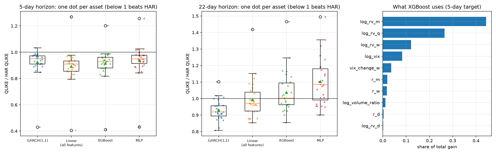
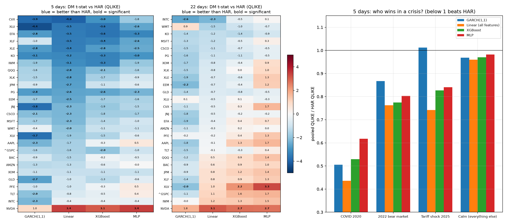
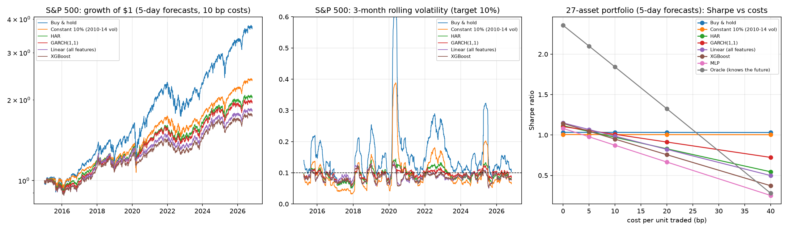

# Does ML beat GARCH? Volatility forecasting with honest evaluation

A computational finance project: forecasting the volatility of the S&P 500 and 26 ETFs and large stocks with classical econometric models and machine learning, and comparing them **out of sample**, with walk-forward validation and statistical tests. Whatever the result, the method is the point: a model only counts as better if it is better on data it has never seen, by more than luck would explain.

## Highlights

- **Data:** 4,232 trading days of the S&P 500 (2010 to Oct 2026) plus the VIX. Daily returns have excess kurtosis **13.5** (normal: 0), and the VIX sits above subsequent realized vol on **86%** of days.
- **Volatility clustering:** returns themselves are nearly unpredictable, but the autocorrelation of |returns| is **0.31** at lag 1 and still **0.15** a month later, which is what makes volatility forecastable.
- **Baselines (2015–2026, 2,970 out-of-sample days):** HAR has the lowest MSE at both horizons. GARCH(1,1) has the lowest QLIKE (**3%** below HAR at 5 days, **7%** at 22 days). The two loss functions disagree, so "best model" depends on how you score it.
- **Machine learning (27 assets, 80,000 out-of-sample asset-days):** XGBoost and a small neural network do **not** beat a plain linear regression on the same features. At 5 days, QLIKE relative to HAR is **0.893** for the linear model, 0.915 for XGBoost and 0.938 for the MLP. At 22 days XGBoost loses to HAR on 15 of 27 assets and the MLP on 20. The gains over HAR come from better inputs (logs, the VIX, quarterly vol), not from non-linear models.
- **Statistically tested (Diebold–Mariano, pooled over 27 assets):** at 5 days the linear model beats HAR (QLIKE ratio 0.879, p = 0.006), and XGBoost is significantly *worse* than the linear model (p = 0.008). At 22 days only GARCH beats HAR (p = 0.043). MSE is too noisy to separate any two models on almost any asset.
- **Crises:** in COVID 2020 every model cuts HAR's QLIKE by 38–56%. In 2022 and the April 2025 tariff shock, the linear model with the VIX does best (0.74–0.76 of HAR), while GARCH is no better than HAR in 2025.
- **Does it pay? (volatility targeting, 27 assets, 10 bp costs):** sizing each position to 10% / forecast vol makes risk far steadier (the variability of 3-month vol falls from 0.43 to 0.15–0.20) and cuts drawdowns, but **better forecasts do not earn a better Sharpe ratio**. The most accurate model by QLIKE (linear) has a portfolio Sharpe of 0.99, HAR 0.97, GARCH 1.01, XGBoost 0.95, the MLP 0.87; none differs significantly from HAR at 5 days. What decides it is **turnover**: GARCH's smooth forecasts trade least, and at 20 bp it leads clearly. An oracle that knows the future would reach 1.84, so the gap is not in the idea but in how little of the future any model sees.
- **No look-ahead, tested:** a unit test scrambles all returns after a cutoff date and checks that no forecast made before it changes. Each test fails when the bug is planted on purpose.

## Phases

| Phase | Content | Status |
|---|---|---|
| 1 | Data: S&P 500 + VIX, realized volatility, stylized facts | ✅ |
| 2 | Baselines: historical vol, EWMA, GARCH(1,1), HAR | ✅ |
| 3 | ML: linear regression, XGBoost and a small neural network on vol, returns, volume and VIX features | ✅ |
| 4 | Evaluation: Diebold–Mariano tests, crisis periods | ✅ |
| 5 | Application: volatility targeting with transaction costs (Sharpe ratio, drawdown) | ✅ |

## Results

### Phase 1: data and stylized facts


Realized volatility over the past $h$ days, annualized, is

$$
\mathrm{RV}_t^{(h)} = \frac{252}{h}\sum_{i=0}^{h-1} r_{t-i}^2 ,
$$

where $r_t$ is the daily log return. The plot shows the three facts every model in this project tries to exploit:

- volatility comes in **bursts** (2011, 2015, 2018, COVID 2020, 2022, April 2025), with a 22-day vol median of 12.5% and a peak of 93.5%;
- big moves are followed by big moves: |returns| stay autocorrelated for about 80 trading days;
- the VIX (the market's 30-day *implied* vol) is above subsequent realized vol on average by **3.7 vol points**: investors pay a premium for protection.

Full statistics in [results/phase1_table.md](results/phase1_table.md).

### Phase 2: baselines


Four forecasts of the realized variance over the next 5 and 22 days:

- **Historical:** the last 22 days' realized variance.
- **EWMA** (RiskMetrics, λ = 0.94): an exponentially weighted average of squared returns.
- **GARCH(1,1)** with Student-t errors: $\sigma^2_t = \omega + \alpha r^2_{t-1} + \beta \sigma^2_{t-1}$.
- **HAR:** a linear regression on the realized variance of the last day, week and month.

GARCH and HAR are re-estimated every 22 trading days on all data available at that date (expanding window).

| Horizon | Model | MSE / HAR | QLIKE / HAR |
|:--|:--|--:|--:|
| 5 days | Historical (22d) | 1.40 | 1.29 |
| 5 days | EWMA | 1.20 | 1.14 |
| 5 days | GARCH(1,1) | 1.02 | **0.97** |
| 5 days | HAR | **1.00** | 1.00 |
| 22 days | Historical (22d) | 1.64 | 1.44 |
| 22 days | EWMA | 1.34 | 1.31 |
| 22 days | GARCH(1,1) | 1.35 | **0.93** |
| 22 days | HAR | **1.00** | 1.00 |

- Historical vol and EWMA are clearly worse: they react late and never pull volatility back to its long-run level.
- HAR versus GARCH depends on the loss. HAR is fitted by least squares, so it is tuned for MSE, which is dominated by a few crisis days. GARCH is fitted by maximum likelihood, which is close to QLIKE, a loss that punishes *under*-predicting volatility.
- Fitted GARCH: α + β = 0.988, so a shock to variance has a half-life of about 58 days.

Whether these gaps are larger than noise is phase 4's job (Diebold–Mariano tests). Absolute losses and fitted parameters in [results/phase2_table.md](results/phase2_table.md).

### Phase 3: machine learning



The universe grows to 27 assets: the S&P 500, 11 ETFs (Nasdaq, small caps, international, emerging markets, Treasuries, gold, sectors) and 15 large stocks. Ten features, all known at the close of day $t$:

- past realized variance over 1, 5, 22 and 66 days (in logs);
- past returns over 1, 5 and 22 days (falling prices tend to raise volatility: the *leverage effect*);
- volume relative to its past month;
- the VIX level and its change over a week.

Three models learn $\log$ of the future realized variance:
- a **linear regression** on all features, as a control;
- **XGBoost** (300 trees of depth 3);
- an **MLP** (hidden layers of 32 and 16 neurons).

Each is one model pooled across all assets, re-trained once a year on every row whose target was already known. Hyperparameters were fixed in advance, never tuned on the test years. Predicting $\log$ variance gives the median, not the mean, so predictions are scaled up by Duan's smearing factor. HAR and GARCH are still fitted per asset, as in phase 2.

| Horizon | Model | QLIKE / HAR, mean (median) | beats HAR (QLIKE) | MSE / HAR, mean (median) | beats HAR (MSE) |
|:--|:--|--:|--:|--:|--:|
| 5 days | GARCH(1,1) | 0.924 (0.952) | 26/27 | **0.944** (0.955) | 18/27 |
| 5 days | Linear (all features) | **0.893** (0.910) | 26/27 | 0.968 (0.957) | 19/27 |
| 5 days | XGBoost | 0.915 (0.930) | 26/27 | 1.010 (1.009) | 13/27 |
| 5 days | MLP | 0.938 (0.948) | 23/27 | 1.171 (1.127) | 5/27 |
| 22 days | GARCH(1,1) | **0.929** (0.919) | 24/27 | 1.027 (1.012) | 12/27 |
| 22 days | Linear (all features) | 0.994 (0.970) | 19/27 | **0.953** (0.956) | 22/27 |
| 22 days | XGBoost | 1.037 (1.002) | 12/27 | 1.098 (1.044) | 9/27 |
| 22 days | MLP | 1.104 (1.085) | 7/27 | 1.640 (1.650) | 0/27 |

- **ML doesn't beat the linear model.** At 5 days XGBoost comes close to it on QLIKE but never passes it, and the MLP is behind on every measure. At 22 days both are worse than plain HAR. With about 250 new rows per asset per year and a very noisy target, there is little non-linear structure left to find, and flexible models mostly fit noise.
- **The inputs matter more than the model.** The linear regression beats HAR on 26 of 27 assets (5-day QLIKE) because it works in logs and sees the VIX and longer-term vol. XGBoost confirms this: 83% of its gain comes from past volatility, 12% from the VIX, and only about 5% from returns and volume.
- **GARCH is still the best single model on QLIKE at 22 days**, ahead of every ML model.
- **A fragile baseline nearly fooled me.** A linear HAR can predict a variance below zero right after a one-day crash, and QLIKE then explodes. That made every model look much better than HAR on XOM, CVX and XLE. HAR now falls back to the past month's variance when its forecast drops below anything seen in training (an "insanity filter").

Full table and feature importance in [results/phase3_table.md](results/phase3_table.md).

### Phase 4: honest evaluation



A lower average loss could be luck. The **Diebold–Mariano test** asks whether the average difference in loss between two models, $\bar d = \frac{1}{n}\sum_t (L^A_t - L^B_t)$, is far from zero compared with its standard error. Because the $h$-day targets overlap and volatility clusters, $d_t$ is autocorrelated, so the standard error uses Newey–West with $2h$ lags. A unit test shows why: on overlapping data where both models are equally good, the naive formula "finds" a difference 37% of the time, Newey–West about 7%.

**Pooled over the 27 assets** (QLIKE averaged across assets each day; QLIKE is scale-free, so every asset counts the same):

| Horizon | Comparison | Loss ratio | p-value |
|:--|:--|--:|--:|
| 5 days | Linear (all features) vs HAR | **0.879** | **0.006** |
| 5 days | GARCH(1,1) vs HAR | 0.910 | 0.015 |
| 5 days | XGBoost vs HAR | 0.902 | 0.017 |
| 5 days | MLP vs HAR | 0.923 | 0.055 |
| 5 days | **XGBoost vs Linear** | 1.026 | **0.008** (XGBoost worse) |
| 5 days | **MLP vs Linear** | 1.050 | **< 0.001** (MLP worse) |
| 22 days | GARCH(1,1) vs HAR | **0.926** | **0.043** |
| 22 days | Linear (all features) vs HAR | 0.988 | 0.750 |
| 22 days | XGBoost vs HAR | 1.034 | 0.448 |
| 22 days | MLP vs Linear | 1.110 | 0.013 (MLP worse) |

- **At 5 days** the linear model is significantly better than HAR on 16 of 27 assets, and worse only on NVDA. XGBoost is better on 10, the MLP on 6. Pooled, both ML models are **significantly worse than the linear model**.
- **At 22 days** almost nothing is significant. Only GARCH beats HAR pooled; per asset, nothing beats HAR on more than 3 of 27.
- **MSE can't separate the models:** with MSE, no model is significantly better or worse than HAR on more than 2 assets in either direction. A few crisis days dominate it, so its standard error is huge.

**By period** (5 days, pooled QLIKE relative to HAR; * = significant at 5%):

| Period | Days | GARCH | Linear | XGBoost | MLP |
|:--|--:|--:|--:|--:|--:|
| COVID 2020 | 94 | 0.51 | **0.44** | 0.53 | 0.62 |
| 2022 bear market | 251 | 0.87* | **0.76*** | 0.77* | 0.80* |
| Tariff shock 2025 | 47 | 1.01 | **0.74** | 0.83 | 0.84 |
| Calm (everything else) | 2,578 | 0.97* | **0.96*** | 0.97 | 0.98 |

- Crises are where the models differ most. HAR in levels reacts badly to sudden jumps, and in COVID every other model cuts its loss by 38–56%.
- The linear model with the VIX does best in every period, probably because the VIX jumps on the first day of a crisis while past volatility needs time to catch up.
- In calm markets all models are within 4% of HAR.
- Crisis windows are short (47–251 days), so their tests are weak. With 94 days, even a 56% reduction in COVID is not significant, and the unit test shows Newey–West over-rejects somewhat in short samples.

Full tables, including both horizons, in [results/phase4_table.md](results/phase4_table.md).

### Phase 5: does a better forecast make money?



**Volatility targeting:** each day, at the close, hold $w_t = \min(10\% / \hat\sigma_t,\ 2)$ of each asset, where $\hat\sigma_t$ is a model's forecast vol. When volatility is forecast to rise, the position shrinks. Every trade costs 10 bp of the amount traded; cash earns nothing. Each of the 27 assets is traded on its own, and the portfolio holds all 27 with equal weight. Benchmarks: buy-and-hold, a **constant** position sized to 10% vol using 2010–14 data only (same average risk, but no timing), and an **oracle** that knows the future realized variance (impossible: an upper bound).

**Equal-weight portfolio, 5-day forecasts, rebalanced daily (2015–2026):**

| Strategy | Return / yr | Vol | Sharpe | Max drawdown | Turnover / yr | Vol of vol | p (Sharpe vs HAR) |
|:--|--:|--:|--:|--:|--:|--:|--:|
| Buy & hold | +16.3% | 15.8% | 1.03 | -30% | 0.1x | 0.57 | 0.61 |
| Constant 10% (2010–14 vol) | +7.6% | 7.5% | 1.01 | -16% | 0.0x | 0.59 | 0.78 |
| HAR | +5.9% | 6.1% | 0.97 | -9% | 8.6x | 0.30 | |
| GARCH(1,1) | +6.0% | 5.9% | **1.01** | -9% | **5.6x** | 0.25 | 0.20 |
| Linear (all features) | +5.6% | 5.6% | 0.99 | **-8%** | 9.1x | **0.21** | 0.80 |
| XGBoost | +5.5% | 5.8% | 0.95 | -9% | 11.0x | 0.22 | 0.68 |
| MLP | +5.0% | 5.7% | 0.87 | -10% | 11.9x | 0.23 | 0.10 |
| Oracle (knows the future) | +10.5% | 5.7% | 1.84 | -7% | 29.8x | 0.17 | 0.000 |

*Vol of vol* = std / mean of the 3-month rolling volatility (lower is steadier risk). p-values from a circular block bootstrap of the Sharpe difference.

- **Targeting does its job on risk.** Per asset, 3-month volatility varies about half as much (0.15–0.20 vs 0.43), and drawdowns relative to risk are smaller: the constant-risk portfolio loses 16% at 7.5% vol, the targeted ones about 9% at 6%.
- **It does not raise the Sharpe ratio.** No forecasting model beats buy-and-hold (1.03) after costs, and none is significantly different from HAR at 5 days. At 22 days the MLP is significantly *worse* (p = 0.02).
- **Accuracy and profit rank differently.** Before costs the ranking follows phase 4 (linear 1.15, XGBoost 1.14, HAR 1.11). After costs it follows **turnover**: ML forecasts jump around more, so they trade more. GARCH is the smoothest and wins from 10 bp up; at 40 bp it keeps 0.72 while the MLP falls to 0.25.
- **The oracle shows what is at stake:** a Sharpe of 1.84 with perfect variance forecasts. Part of that is not volatility at all: knowing the variance means knowing a crash is coming, and crashes are also where returns are worst.

Full tables, per-asset averages and both horizons in [results/phase5_table.md](results/phase5_table.md).

## Usage

```bash
python -m venv .venv
.venv/Scripts/activate          # Windows; on macOS/Linux: source .venv/bin/activate
pip install -r requirements.txt
python -m pytest
python -m experiments.phase1_data        # downloads data/ on the first run (Yahoo Finance), then works offline
python -m experiments.phase2_baselines
python -m experiments.phase3_ml          # ~15 minutes (GARCH on 27 assets); caches forecasts in data/
python -m experiments.phase4_evaluation  # uses phase 3's cached forecasts
python -m experiments.phase5_strategy    # uses phase 3's cached forecasts
```

## Layout

```
volfc/          Python package: data and realized vol, baselines, features, walk-forward ML, loss functions, volatility targeting
experiments/    one script per phase; each regenerates its plot and table in results/
tests/          pytest suite
data/           cached Yahoo Finance downloads and forecasts (git-ignored; prices up to 2026-10-30)
```
